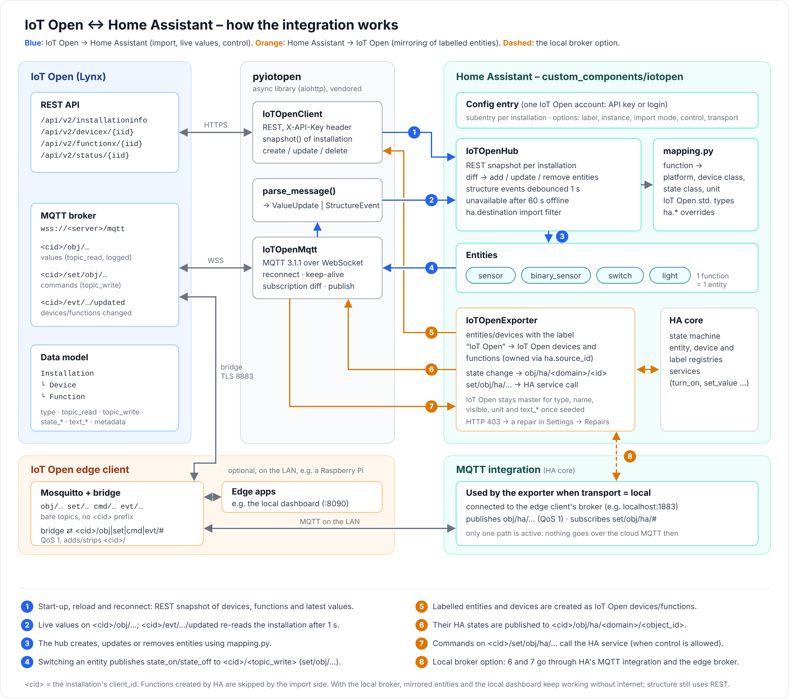

# IoT Open for Home Assistant

[](https://my.home-assistant.io/redirect/hacs_repository/?owner=automateit-se&repository=ha-iotopen&category=integration)
[](https://my.home-assistant.io/redirect/config_flow_start/?domain=iotopen)

Connects [IoT Open](https://iotopen.se) (Lynx) and Home Assistant in both directions:

- **Import:** every IoT Open function becomes a Home Assistant entity. Values are pushed live over MQTT, so nothing
  is polled.
- **Mirroring:** Home Assistant entities and devices that carry the label **IoT Open** are created as devices and
  functions in an IoT Open installation. Their states are published there, and IoT Open can control them.



*Source: [docs/architecture.svg](docs/architecture.svg)*

| IoT Open | Home Assistant |
|---|---|
| Account | Config entry |
| Installation | Config subentry |
| Device | Device |
| Function | Entity, `unique_id` = `iotopen_<installation>_<function>` |

## Installation

### HACS (recommended)

1. In HACS, go to *⋮ → Custom repositories*, add `https://github.com/automateit-se/ha-iotopen` and choose the
   type *Integration*. This step is needed until the integration is in the HACS default list; before that, the
   first button above only shows "Repository not found".
2. Click the first button above, or search for **IoT Open** in HACS. Install it and restart Home Assistant.
3. Click the second button above, or go to *Settings → Devices & services → Add integration → IoT Open*.

### Manual

Copy `custom_components/iotopen` to `/config/custom_components/iotopen` and restart.

There are no compiled dependencies, so it runs fine on Home Assistant OS on a Raspberry Pi. The async client
library [`pyiotopen`](pyiotopen/) (pure Python on top of `aiohttp`) is bundled inside the integration.

## Setup

1. **Server URL**: prefilled with `https://lynx.iotopen.se`.
2. **Sign-in method**:
   - **API key (recommended)**: never expires.
   - **Username and password**: supports two-factor authentication. The password is only used to get a token and is
     never stored. Tokens expire, and Home Assistant then asks you to sign in again.
3. **Installations**: choose which ones to add. Each installation becomes a subentry. More can be added later with
   *Add installation* on the integration page.

If the key is revoked or the token expires, Home Assistant starts a re-authentication flow.

### Options (*Configure*)

| Option | Meaning |
|---|---|
| Mirror Home Assistant into installation | The IoT Open installation that labelled entities are mirrored into. `-` turns mirroring off. |
| Label that selects what is mirrored | Default `IoT Open`. The label is created automatically. |
| Allow IoT Open to control Home Assistant | Mirrored switches, lights, locks, covers, numbers, media players, thermostats, … get a `topic_write`. |
| Mirror diagnostic and configuration entities of labelled devices | Off by default. See [Mirroring](#mirroring-home-assistant--iot-open). |
| Send values and receive commands via | *IoT Open (cloud)* (default) or *Local broker*. See [Local broker](#local-broker-mirroring-without-internet). |
| This Home Assistant's name in IoT Open | Instance name used in `ha.source` and `ha.destination`. |
| Import from IoT Open | *Only tagged* (default): only devices/functions whose `ha.destination` names this instance. *All*: every function in the selected installations. |

The API key's user needs write access to devices and functions in the mirror installation. Without it, IoT Open
answers HTTP 403, and Home Assistant shows a repair under *Settings → Repairs* that names the installation. Mirroring
is retried every minute, and the repair disappears by itself once the user has been given access.

## Import: IoT Open → Home Assistant

### Choosing what to import

With *Only tagged*, set the metadata key `ha.destination` on an IoT Open device or function:

- the instance name, for example `home`, or a comma-separated list such as `home, cabin`;
- the long instance id shown in the options dialog;
- `*` for every Home Assistant instance.

A value on a function overrides the value on its device. Objects created by Home Assistant itself are never imported
back.

### How functions are mapped

IoT Open standard function types are recognised, each with its own state keys:

| Function | Entity |
|---|---|
| `type: dimmer` (`min`/`max`, `topic_write`, optional `topic_read_onoff`/`topic_write_onoff`) | `light` with brightness |
| `topic_write` + `state_on`/`state_off` | `switch`: sends `state_on`/`state_off` to `topic_write`; the state follows `topic_read` |
| `type: door` (`state_open`/`state_closed`) | `binary_sensor`, device class *door* |
| `type: movement` (`state_movement`/`state_nomovement`) | `binary_sensor`, device class *motion* |
| `type: boolean_text` (`state_true`/`state_false`) | `binary_sensor` |
| `state_on`/`state_off`, no `topic_write` | `binary_sensor`, device class from `type` (fault → problem, …) |
| anything else | `sensor`: device/state class from `type` and `unit`, precision from `format` |

Examples: `unit: kWh` becomes energy with *total increasing*. `type: temperature` with `unit: C` becomes a
temperature sensor in °C with *measurement*. A sensor without a unit gets a text state.

Functions with a `device_id` show up on that device, with manufacturer and model taken from the device metadata. A
hub device for the installation is only created when some functions have no device.

### Overrides (function metadata in IoT Open)

| Key | Example | Effect |
|---|---|---|
| `ha.platform` | `sensor`, `binary_sensor`, `switch`, `light`, `none` | Force the platform, or `none` to skip the function |
| `ha.device_class` | `temperature`, `door`, `none` | Force the device class |
| `ha.state_class` | `measurement`, `total_increasing`, `none` | Force the state class |
| `ha.unit` | `kWh` | Override `unit` |
| `ha.hidden` | `true` | Hide the entity (it stays available to automations) |

### Live updates

- At start-up, reload and reconnect, the integration reads a REST snapshot (`devicex`, `functionx`, `status`).
- After that, values arrive over MQTT on `wss://<server>/mqtt`.
- When a function or device is created, changed or deleted, IoT Open publishes `<client_id>/evt/functionx/updated` or
  `…/evt/devicex/updated`. The integration then re-reads that installation (debounced 1 s) and adds, updates or
  removes entities and devices right away.
- If the connection is down for more than 60 s, entities become *unavailable*. After a reconnect everything is
  re-read, so no values are missed.

## Mirroring: Home Assistant → IoT Open

Put the label **IoT Open** on an entity, or on a device to mirror all of its entities. The label has an IoT Open icon.

A label on a device skips the device's hidden entities and, by default, its diagnostic and configuration entities.
Many devices have lots of these: a phone with the mobile app, for example, brings battery level, battery state,
charger type, network type, Wi-Fi name and more, and a speaker brings settings such as bass, treble and loudness. To
mirror them too, turn on *Mirror diagnostic and configuration entities of labelled devices* under *Configure*. A
label put directly on an entity is always mirrored, whatever its category.

| Home Assistant | IoT Open |
|---|---|
| Device | Device (type `HomeAssistant`, metadata `name`, `manufacturer`, `model`, `ha.device_id`) |
| Entity | Function, `topic_read` = `obj/ha/<domain>/<object_id>` |
| Controllable entity | also `topic_write` = `set/obj/ha/<domain>/<object_id>` |
| State change | `{"value", "timestamp", "msg"}` published to `<client_id>/obj/ha/…` |
| Message on `set/obj/ha/…` | Home Assistant service call (`turn_on`/`turn_off`, `set_value`, `open`/`close`, `lock`/`unlock`, `press`) |

Entities are mapped to IoT Open standard types: `switch` for on/off domains, `dimmer` for dimmable lights (level on
`obj/ha/light/<id>`, on/off on `…/onoff`), `door` and `movement` for those binary sensor classes, and `boolean_text`
for other binary sensors. Domains without a meaningful value (`event`, `update`, `camera`, …) are not mirrored.

### Media players

A media player (for example a Sonos speaker) becomes several functions on the same IoT Open device. The topics start
with `obj/ha/media_player/<object_id>`, and each function carries `ha.part`:

| Function | Type | Topic | Control (`set/…`) |
|---|---|---|---|
| *&lt;name&gt; Playback* | `switch`: 1 = playing, 0 = otherwise | `…/playing` | `media_play` / `media_pause` |
| *&lt;name&gt; Volume* | `dimmer`, 0-100 % | `…/volume` | `volume_set` |
| *&lt;name&gt; Mute* | `switch` | `…/mute` | `volume_mute` |
| *&lt;name&gt; Status* | text, read only (`playing`, `paused`, `idle`, `off`, `unavailable`, …) | `…/state` | - |
| *&lt;name&gt; Power* | `switch` | `…/power` | `turn_on` / `turn_off` |

- Only the functions the player supports are created; *Status* is always there. If the player loses a feature, the
  function is removed. An unavailable player keeps its functions.
- The names are in Swedish when Home Assistant's language is Swedish (*Uppspelning*, *Volym*, *Mute*, *Status*,
  *På/av*). As for other functions, a name changed in IoT Open is kept.
- **The track is in `msg`.** *Playback* sends `msg` = `Artist - Title` (only the title when there is no artist, the
  station for radio without a title), shortened to 200 characters. A new track while playing gives a new message
  with the same value, so the IoT Open log shows what was played. On pause the text stays; when the player is idle or
  off, `msg` is empty. The other functions send an empty `msg`.
- Values are only published when they change, so position and artwork updates do not fill the history. Volume is
  published about 1 s after the last change, so dragging a slider gives one value.
- The state follows Home Assistant: a command from IoT Open is confirmed when the player reports the new state.
- `topic_write` is only set when *Allow IoT Open to control Home Assistant* is on.

### Thermostats

A thermostat (`climate`) becomes up to four functions on the same IoT Open device, on
`obj/ha/climate/<object_id>/<part>`:

| Function | Type | Topic | Control (`set/…`) |
|---|---|---|---|
| *&lt;name&gt; Temperature* | `temperature`, read only | `…/current` | - |
| *&lt;name&gt; Target temperature* | `setpoint`, with `min`, `max` and `step` from Home Assistant | `…/target` | `set_temperature` |
| *&lt;name&gt; Mode* | text (`off`, `heat`, `cool`, `auto`, …), the modes the thermostat offers in `ha.hvac_modes` | `…/mode` | `set_hvac_mode` |
| *&lt;name&gt; Action* | text, read only (`heating`, `idle`, `off`, …) | `…/action` | - |

- *Mode* is always created; the others when the thermostat reports the value. An unavailable thermostat keeps its
  functions.
- The unit is Home Assistant's temperature unit. The names are in Swedish when Home Assistant's language is Swedish
  (*Temperatur*, *Börvärde*, *Läge*, *Drift*).
- The IoT Open Dashboard (0.12.0 or later) shows the four functions as one thermostat widget.

**Ownership.** Objects created by Home Assistant carry `ha.source` (the readable instance name) and `ha.source_id`
(the stable instance id). Only objects with this instance's `ha.source_id` are created, updated or deleted by the
mirror. Your own metadata keys are left alone.

**IoT Open is master for presentation.** `name`, `visible`, `unit` and `text_*` are only seeded by Home Assistant. If
you change them, or change the function type (for example `boolean_text` → `door`), in IoT Open, the change is kept.
Delete a key in IoT Open to get Home Assistant's value back. Structural keys (`topic_*`, `ha.*`, `device_id`,
`min`/`max`) always follow Home Assistant.

Tip: use a separate IoT Open user for the integration, so the IoT Open log shows who changed what.

### Local broker: mirroring without internet

By default, mirrored values and commands go over IoT Open's cloud MQTT. When the mirror installation has an
**edge client on the same network** (for example an IoT Open Raspberry Pi), choose *Local broker* under *Configure* to
send them through the edge client's own broker instead:

- Home Assistant publishes `obj/ha/…` on the edge client's broker (without the client id prefix) and listens to
  `set/obj/ha/#` there.
- The edge client's bridge forwards the values to IoT Open and brings commands from IoT Open down, exactly as for the
  edge client's own apps. Each command arrives once.
- The [local dashboard](https://github.com/automateit-se/edge-app-local-dashboard) and Home Assistant keep talking to
  each other **without internet**: values update and switches work. While the bridge is down, IoT Open's history may
  get a gap (the broker only queues a limited number of messages).
- Devices and functions are still created and changed over IoT Open's REST API, so labelling new entities needs
  internet.

Requirements: Home Assistant's [MQTT integration](https://www.home-assistant.io/integrations/mqtt/), connected to the
edge client's broker (for example `localhost:1883` when Home Assistant runs on the edge client itself). The option
cannot be chosen without it. Importing functions from IoT Open still uses the cloud.

## Diagnostics

*Settings → Devices & services → IoT Open → ⋮ → Download diagnostics*. Tokens and personal metadata (address,
coordinates, e-mail) are redacted.

For debug logging, add this to `configuration.yaml`:

```yaml
logger:
  logs:
    custom_components.iotopen: debug
```

## Development

```bash
python3.13 -m venv .venv && . .venv/bin/activate
pip install -r requirements_test.txt
pytest                       # integration tests (mocked Lynx)
pytest pyiotopen/tests       # library tests (fake Lynx REST + MQTT broker)
python tools/sync_vendor.py  # after changing pyiotopen/src, refresh the bundled copy
```

See [CONTRIBUTING.md](CONTRIBUTING.md) for how to work on the code and make a release, and
[docs/DEVELOPMENT.md](docs/DEVELOPMENT.md) for design decisions, status and the roadmap.

## Support

Report bugs and ideas under [Issues](https://github.com/automateit-se/ha-iotopen/issues). Please attach the
diagnostics file (see above) to bug reports.

Licensed under [MIT](LICENSE).
